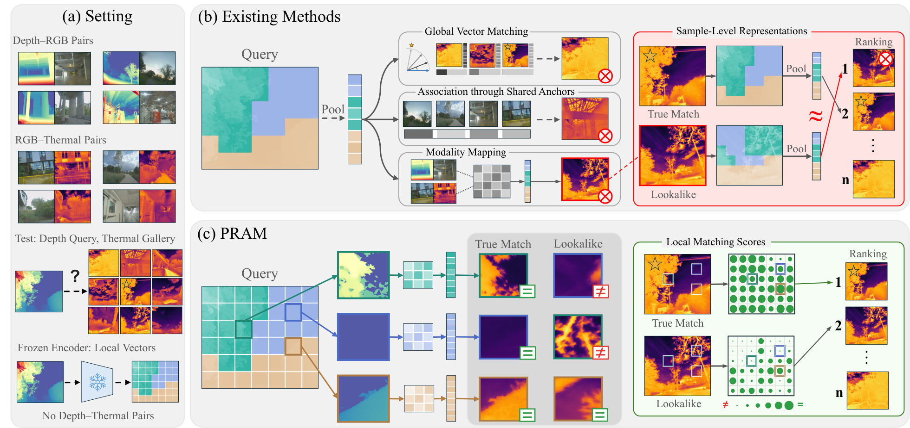
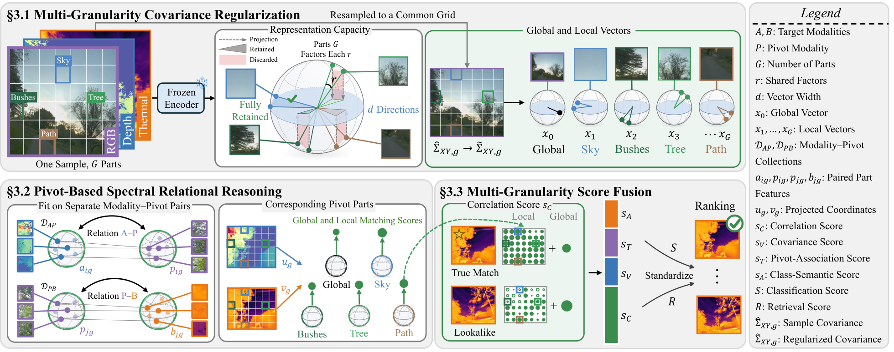

<div align="center">

<h1><a href="https://luo1yan.github.io/PRAM/">PRAM: Activating Latent Multimodal Knowledge through Partwise Reasoning</a></h1>

[](https://luo1yan.github.io/PRAM/)
[](https://huggingface.co/datasets/Rowance/PRAM-features)
[](LICENSE)


*Activating Latent Multimodal Knowledge in Frozen Encoders via Partwise Statistical Reasoning*

</div>

---

## ✨ Overview

<p align="center">
  
</p>

**Partwise Reasoning across Modalities (PRAM)** enables emergent cross-modal classification and retrieval between target modalities $A$ and $B$ that were never paired during training, while keeping all pretrained multimodal encoders completely frozen.

> **Key Insight**: Collapsing multi-part spatial or temporal representations into a single global vector discards fine-grained cross-modal relations already computed inside frozen encoders. Composing regularized partwise statistical relations through corresponding parts of a shared pivot modality recovers this latent knowledge in closed form.

---

## 🎯 Key Features

- **Zero Direct Target Pairs & Frozen Encoders** — Fits solely on two separate modality–pivot collections ($\mathcal{D}_{AP}$ and $\mathcal{D}_{PB}$) with zero encoder updates.
- **Partwise Statistical Composition** — Preserves both global and spatial/temporal local vectors with adaptive cross-part covariance shrinkage (MCR) and contraction-guaranteed equal-edge spectral reasoning (PSRR).
- **Task-Adaptive Score Fusion** — Combines correlation, covariance-map, pivot-association, and class-semantic scores with fixed training-bank standardization (MSF) for both retrieval and classification.
- **Config-Driven Reproducibility** — Unified `run.py` entry point and JSON experiment configs covering all main benchmarks, ablations, real-world sensing scenarios, and mechanism analyses.
- **Pre-Extracted Feature Packs on Hugging Face** — Auto-download standardized `.npz` feature packs from [`Rowance/PRAM-features`](https://huggingface.co/datasets/Rowance/PRAM-features) or extract fresh features from raw datasets via `scripts/`.

---

## 🏗️ Architecture

<p align="center">
  
</p>

PRAM operates in three closed-form statistical modules:

1. **Multi-Granularity Covariance Regularization (`pram/mcr.py`)** — Retains global and local vectors from frozen encoders, applies edge-wise centering with modality scalar scaling, and stabilizes local covariance estimation through adaptive cross-part shrinkage.
2. **Pivot-Based Spectral Relational Reasoning (`pram/psrr.py`)** — Composes regularized $A$–$P$ and $P$–$B$ covariances via equal-edge pivot averaging ($H_g$), whitens endpoints ($\lambda = 0.5$), extracts paired projection directions with bounded singular values ($\sigma_{gk} \le 1$), and computes composite Gaussian log-likelihood ratio scores.
3. **Multi-Granularity Score Fusion (`pram/msf.py`)** — Fuses global and local correlation scores ($s_C$) with covariance-weighted pivot-map cosine scores ($s_V$), applies symmetric training-bank standardization (up to 2,000 fixed rows per endpoint), and incorporates cross-fitted discriminant pivot-association ($s_T$) and class-semantic ($s_A$) scores for classification.

---

## ⚡ Quick Start

```bash
# Clone repository and install
git clone https://github.com/Luo1Yan/PRAM.git
cd PRAM
pip install -e .

# Run a single real benchmark setting (auto-downloads IB UTD-MHAD depth-IMU from Hugging Face)
python run.py \
    --config configs/quick_real.json \
    --relations ib_utd_depth_imu \
    --hf_repo Rowance/PRAM-features \
    --data_dir ./data_cache \
    --output results/ib_utd_depth_imu.json
```

Run the complete starter real-dataset bundle (6 public main benchmark settings across ImageBind and LanguageBind) or the wearable IMU-only sensing benchmark directly:

```bash
# 6 public main benchmark settings (UTD-MHAD, VGGSound, CART, MAVD, MSR-VTT)
python run.py \
    --config configs/quick_real.json \
    --hf_repo Rowance/PRAM-features \
    --data_dir ./data_cache \
    --output results/quick_real.json

# Real-world wearable IMU-only action recognition (UTD-MHAD & CZU-MHAD, 3-seed C3T protocol)
python run.py \
    --config configs/sensing_wearable.json \
    --hf_repo Rowance/PRAM-features \
    --data_dir ./data_cache \
    --output results/sensing_wearable.json
```

---

## 🔧 Installation & Data Preparation

### Prerequisites

- **Python** 3.10 or higher
- **PyTorch** 2.0 or higher (runs seamlessly on both CPU and CUDA)
- **NumPy** 1.24+, **huggingface_hub** 0.23+

```bash
git clone https://github.com/Luo1Yan/PRAM.git
cd PRAM
pip install -r requirements.txt
```

### Option A: Pre-Extracted Frozen Feature Packs (Recommended)

Standardized feature packs (`float32` global + `float16` local `.npz`) are hosted on Hugging Face at [`Rowance/PRAM-features`](https://huggingface.co/datasets/Rowance/PRAM-features). Passing `--hf_repo Rowance/PRAM-features` to `run.py` downloads each required pack automatically into `--data_dir` on first use and reuses the local cache thereafter.

Expected local cache layout under `--data_dir` (default `./data_cache`):

```text
data_cache/
└── packs/
    ├── main/
    │   ├── ib_utd_depth_imu.npz
    │   ├── ib_ego4d_audio_imu.npz
    │   ├── ib_ego4d_text_imu.npz
    │   ├── ib_vggsound_text_audio.npz
    │   ├── ib_cart_thermal_imu.npz
    │   ├── ib_mavd_audio_thermal.npz
    │   ├── ib_batvision_audio_depth.npz
    │   ├── ib_tartanrgbt_depth_thermal.npz
    │   ├── ib_tartanrgbt_text_thermal.npz
    │   ├── ib_nyuv2_text_depth.npz
    │   ├── ib_nyuv2_text_depth_category.npz
    │   ├── lb_msrvtt_video_audio.npz
    │   ├── lb_mavd_thermal_audio.npz
    │   ├── lb_batvision_depth_audio.npz
    │   ├── lb_vggsound_image_audio.npz
    │   ├── lb_nyuv2_image_depth.npz
    │   ├── lb_ucf101_image_video.npz
    │   ├── lb_tartanrgbt_image_thermal.npz
    │   ├── lb_tartanrgbt_thermal_depth.npz
    │   ├── lb_tartanrgbt_video_depth.npz
    │   └── lb_tartanrgbt_video_thermal.npz
    └── sensing/
        ├── robot_ms2.npz
        ├── robot_obv.npz
        ├── vehicle_vividpp_to_ms2.npz
        ├── wearable_utd_mhad.npz
        └── wearable_czu_mhad.npz
```

Compact starter packs (`ib_utd_depth_imu`, `ib_vggsound_text_audio`, `ib_cart_thermal_imu`, `ib_mavd_audio_thermal`, `lb_msrvtt_video_audio`, `lb_mavd_thermal_audio`, `wearable_utd_mhad`, and `wearable_czu_mhad`) are immediately available in [`Rowance/PRAM-features`](https://huggingface.co/datasets/Rowance/PRAM-features) under each upstream dataset and encoder's respective non-commercial research terms (see `UPSTREAM_SOURCES.md` and `LICENSES/` in the dataset repository). Ego4D packs (`ib_ego4d_audio_imu`, `ib_ego4d_text_imu`) are excluded from public redistribution under the Ego4D license; authorized Ego4D licensees can build them directly from their local Ego4D v2 download using the dedicated workflow below.

### Reproducing Ego4D (Licensed Users)

Because Ego4D is distributed strictly under its own license agreement, neither raw Ego4D data nor extracted Ego4D features are redistributed. Instead, [`configs/ego4d.json`](configs/ego4d.json) records only the official Ego4D v2 `video_uid`s, window timestamps, narration pass identifiers, and train/test split indices (`1,625` audio–IMU and `2,286` text–IMU windows), and [`scripts/extract_ego4d.py`](scripts/extract_ego4d.py) extracts both frozen ImageBind feature packs directly from a licensed local download:

1. Obtain official Ego4D v2 access via [ego4d-data.org](https://ego4d-data.org/docs/start-here/) and download the `video_540ss` (or `full_scale`) videos, `imu` CSV files, and `annotations/narration.json` for the video UIDs listed in `configs/ego4d.json`.
2. Verify that all required local inputs are in place before running ImageBind:

```bash
python scripts/extract_ego4d.py \
    --ego4d_dir /path/to/ego4d/v2 \
    --check-inputs
```

3. Extract both `ib_ego4d_audio_imu.npz` and `ib_ego4d_text_imu.npz` (shared video and IMU windows are decoded once and reused automatically) and evaluate them with `run.py`:

```bash
python scripts/extract_ego4d.py \
    --ego4d_dir /path/to/ego4d/v2 \
    --output_dir ./data_cache/packs/main \
    --device cuda \
    --compressed

python run.py \
    --config configs/main_imagebind.json \
    --relations ib_ego4d_audio_imu ib_ego4d_text_imu \
    --data_dir ./data_cache \
    --output results/ego4d.json
```

### Option B: Extract Frozen Features from Raw Datasets

To build `.npz` relation packs directly from raw datasets and upstream frozen checkpoints ([ImageBind](https://github.com/facebookresearch/ImageBind), [LanguageBind](https://github.com/PKU-YuanGroup/LanguageBind), [AnyThermal](https://huggingface.co/theairlabcmu/AnyThermal), [DINOv2-B](https://huggingface.co/facebook/dinov2-base), ResNet18, [AnyMo](https://huggingface.co/CRUISEResearchGroup/AnyMo)):

```bash
# ImageBind global + spatial/temporal local features (with optional edge-only spatial registration)
python scripts/extract_imagebind.py --manifest path/to/manifest.json --output data_cache/packs/main/custom_ib.npz

# LanguageBind global + block-12 8x8 spatial / 4-segment temporal local features
python scripts/extract_languagebind.py --manifest path/to/manifest.json --output data_cache/packs/main/custom_lb.npz

# Sensing encoders (AnyThermal, DINOv2-B, ResNet18, AnyMo)
python scripts/extract_sensing.py --manifest path/to/manifest.json --output data_cache/packs/sensing/custom_sensing.npz
```

---

## 🚦 Usage

### Main Cross-Modal Benchmarks (Tables 1 & 2)

```bash
# ImageBind benchmark settings (10 retrieval + 8 classification)
python run.py \
    --config configs/main_imagebind.json \
    --data_dir ./data_cache \
    --hf_repo Rowance/PRAM-features \
    --output results/main_imagebind.json

# LanguageBind benchmark settings (10 retrieval + 9 classification)
python run.py \
    --config configs/main_languagebind.json \
    --data_dir ./data_cache \
    --hf_repo Rowance/PRAM-features \
    --output results/main_languagebind.json
```

### Ablation Studies (Table 3)

```bash
python run.py \
    --config configs/ablations.json \
    --data_dir ./data_cache \
    --hf_repo Rowance/PRAM-features \
    --output results/ablations.json
```

### Real-World Sensing Scenarios

```bash
# Robot thermal-to-depth localization (MS2 & OBV)
python run.py --config configs/sensing_robot.json --data_dir ./data_cache --output results/sensing_robot.json

# Cross-device nighttime vehicle localization (ViViD++ -> MS2)
python run.py --config configs/sensing_vehicle.json --data_dir ./data_cache --output results/sensing_vehicle.json

# Wearable IMU-only action recognition (UTD-MHAD & CZU-MHAD)
python run.py --config configs/sensing_wearable.json --hf_repo Rowance/PRAM-features --data_dir ./data_cache --output results/sensing_wearable.json
```

### Mechanism & Sensitivity Analysis (Table 4 & Sensitivity Controls)

```bash
python run.py \
    --config configs/mechanisms.json \
    --data_dir ./data_cache \
    --hf_repo Rowance/PRAM-features \
    --output results/mechanisms.json
```

### Using PRAM in Your Own Python Code

```python
from pram import (
    ModalityInput,
    PRAM,
    PRAMConfig,
    evaluate_bidirectional_retrieval,
    evaluate_classification,
)

# Frozen global embeddings [N, d0] and optional aligned local vectors [N, G, d_loc]
ap_a = ModalityInput(global_feat=a_global_ap, local_feat=a_local_ap)
ap_p = ModalityInput(global_feat=p_global_ap, local_feat=p_local_ap)
pb_p = ModalityInput(global_feat=p_global_pb, local_feat=p_local_pb)
pb_b = ModalityInput(global_feat=b_global_pb, local_feat=b_local_pb)

# Fit strictly on separate A-P and P-B collections (no direct A-B pairs)
model = PRAM(PRAMConfig()).fit(ap_a, ap_p, pb_p, pb_b, is_class_prompt=False)

# Retrieval readout R and classification readout S (with optional chunk_size)
ret_scores = model.score_retrieval(test_a, test_b, chunk_size=256)
ret_metrics = evaluate_bidirectional_retrieval(ret_scores, ks=(1, 5, 10))
```

---

## 📊 Main Results

Mean retrieval R@10 and classification Top-1 (%) across all 10 benchmark datasets (see the [Project Page](https://luo1yan.github.io/PRAM/) for complete per-setting tables covering all 17 classification, 20 retrieval, and 16 sensing metrics):

| Method | ImageBind R@10 | ImageBind Top-1 | LanguageBind R@10 | LanguageBind Top-1 | Overall Mean |
| :--- | :---: | :---: | :---: | :---: | :---: |
| Frozen Cosine | 11.2 | 16.7 | 32.7 | 65.2 | 31.5 |
| Global-only PRAM | 22.4 | 43.1 | 30.1 | 79.5 | 43.8 |
| Partwise ASIF | 26.5 | 35.6 | 31.3 | 72.1 | 41.4 |
| Partwise MMBind | 28.0 | 44.8 | 27.5 | 72.7 | 43.2 |
| **PRAM (Ours)** | **32.9** | **50.6** | **53.4** | **80.2** | **54.3** |

Real-world sensing highlights (frozen task-specific encoders, zero target-pair supervision):
- **Robot Localization**: **55.3%** within 5 m on MS2 (vs. MINIMA `33.4%`); **31.9%** within 0.25 m on OBV (vs. MINIMA `23.1%`).
- **Cross-Device Nighttime Vehicle Localization (ViViD++ → MS2)**: **26.2%** within 5 m (vs. ThermalGen `9.6%`); **15.0%** on a separate traversal (vs. ASIF `8.3%`).
- **Wearable IMU-Only Action Recognition**: **80.6%** Top-1 on UTD-MHAD (vs. C3T `52.7%`); **90.8%** Top-1 on CZU-MHAD (vs. CA `85.9%`).

---

## 📁 Project Structure

```text
PRAM/
├── README.md
├── LICENSE
├── pyproject.toml
├── requirements.txt
├── run.py                         # Unified CLI entry point for all experiments
├── configs/                       # JSON experiment & estimator configurations
│   ├── default_pram.json          # Default fixed paper hyperparameters
│   ├── quick_real.json            # Starter real-dataset bundle (6 public settings)
│   ├── ego4d.json                 # License-clean Ego4D v2 UID & split protocol
│   ├── main_imagebind.json        # Full ImageBind benchmark settings
│   ├── main_languagebind.json     # Full LanguageBind benchmark settings
│   ├── ablations.json             # Component ablation suite
│   ├── sensing_robot.json         # MS2 & OBV robot localization
│   ├── sensing_vehicle.json       # ViViD++ -> MS2 cross-device vehicle localization
│   ├── sensing_wearable.json      # UTD-MHAD & CZU-MHAD wearable IMU recognition
│   └── mechanisms.json            # Pair-budget, shuffled-pivot & sensitivity analyses
├── pram/                          # Core PyTorch statistical modules
│   ├── config.py                  # PRAMConfig controls and deterministic sampling
│   ├── mcr.py                     # Multi-Granularity Covariance Regularization
│   ├── psrr.py                    # Pivot-Based Spectral Relational Reasoning
│   ├── msf.py                     # Multi-Granularity Score Fusion & reference banks
│   ├── registration.py            # Edge-only spatial offset registration
│   ├── metrics.py                 # Tie-aware expected Recall@K & classification metrics
│   └── model.py                   # High-level PRAM & ModalityInput interface
├── data/                          # Portable feature-pack schema, splits & HF downloader
│   ├── schema.py                  # RelationPack (.npz / .pt) I/O and validation
│   ├── splits.py                  # Disjoint AP/PB halves, pair budgets & C3T splits
│   └── hub.py                     # Local / Hugging Face Hub pack resolution
├── evaluation/                    # Benchmark & sensing scenario evaluators
│   ├── runner.py                  # Main retrieval & classification evaluation
│   ├── ablations.py               # Component ablation suite
│   ├── sensing.py                 # Robot, vehicle & wearable sensing evaluators
│   └── mechanisms.py              # Pair-budget, pivot-shuffle & multi-seed evaluators
├── scripts/                       # Feature extraction & Hugging Face upload helpers
│   ├── extract_ego4d.py           # Turnkey Ego4D v2 extractor for licensed users
│   ├── extract_imagebind.py
│   ├── extract_languagebind.py
│   ├── extract_sensing.py
│   └── upload_to_hf.py
├── tests/                         # End-to-end verification test suite
│   ├── test_pram_e2e.py
│   └── test_ego4d_extractor.py
└── assets/                        # Overview and framework figures
```

---

## ⚙️ Configuration

All fixed estimator controls (`configs/default_pram.json`) can be customized and passed via `--pram_config`:

```json
{
  "relative_ridge": 0.5,
  "max_directions": 256,
  "max_bank_size": 2000,
  "max_gallery_size": 10000,
  "knn_k": 10,
  "state_decimals": 4,
  "lbfgs_max_iter": 200,
  "scale_floor": 1e-12,
  "corr_cap": 0.999999,
  "lda_diag_eps": 1e-6,
  "class_prompt_cv_seed": 7
}
```

Override estimator parameters on any benchmark run without editing code:

```bash
python run.py \
    --config configs/quick_real.json \
    --pram_config configs/default_pram.json \
    --data_dir ./data_cache \
    --device cpu
```

---

## 🧪 Testing

Run the full 34-test unit and end-to-end CLI verification suite on CPU:

```bash
CUDA_VISIBLE_DEVICES=-1 pytest -v
```

---

## Citation

If you find this work useful in your research, please consider citing:

```bibtex
@article{chen2026pram,
  title={PRAM: Activating Latent Multimodal Knowledge through Partwise Reasoning},
  author={Chen, Haidong and Guo, Ying and Li, Shangze and Mao, Zhongkuan and Xu, Linrui and Xiao, Canran and Shen, Fei and Chua, Tat-Seng},
  journal={arXiv preprint},
  year={2026},
  url={https://luo1yan.github.io/PRAM/}
}
```

<div align="center">

**[Back to Top](#pram-activating-latent-multimodal-knowledge-through-partwise-reasoning)**

</div>
